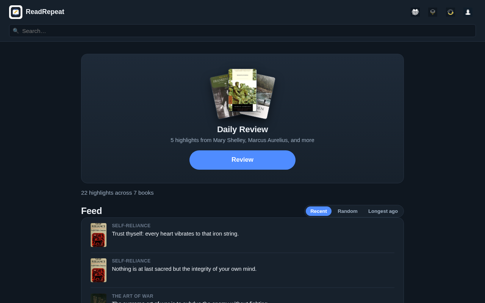
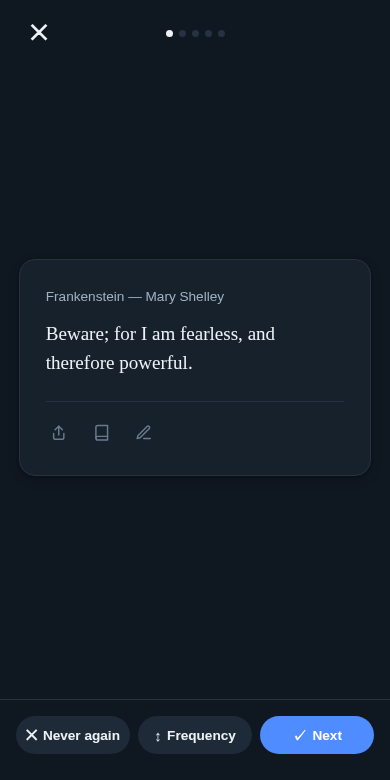
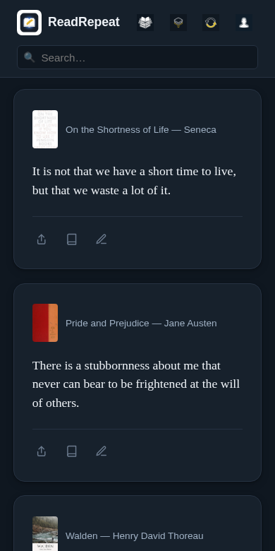
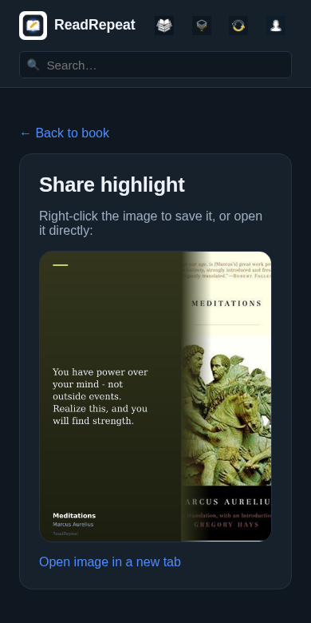
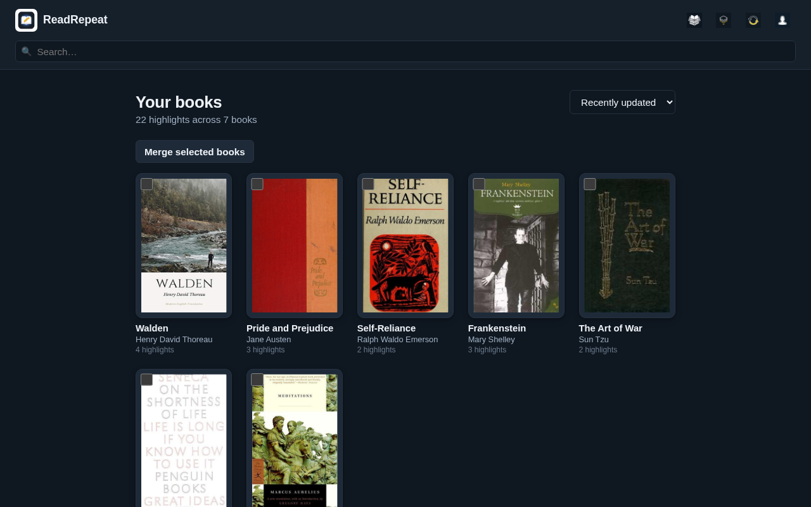
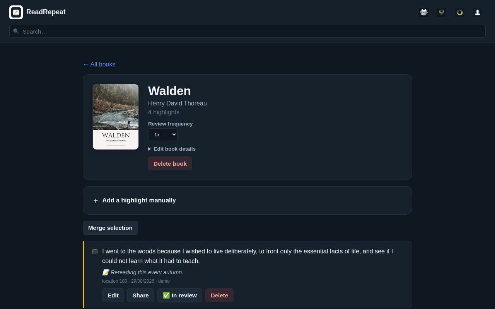

# ReadRepeat

Self-hosted, open-source Readwise alternative: one place for all your book highlights, with spaced-repetition review, automatic cover enrichment, and its own "Instagram mode" that replaces doomscrolling with something that actually sticks with you.

## Why ReadRepeat?

- **Self-hosted** — your highlights live on your own server, no subscription and no third party that can do whatever it wants with your reading data.
- **Open source** — full control over features and privacy, adapt it however you like.
- **Retention over collecting** — spaced repetition makes sure highlights actually stick with you, instead of sinking into an archive forever.
- **An Instagram mode that gives something back** — endless scrolling through your own highlights instead of someone else's content, and it still counts toward your review schedule.

## Screenshots



<table>
  <tr>
    <td width="33%"></td>
    <td width="33%"></td>
    <td width="33%"></td>
  </tr>
  <tr>
    <td align="center">Daily review</td>
    <td align="center">Discover ("Instagram mode")</td>
    <td align="center">Share as image</td>
  </tr>
</table>





<sub>Screenshots use a demo account with public-domain books.</sub>

## Features

**Dashboard**
- Daily Review card with today's highlights, a "done for today" indicator
- Streak counter + calendar (any day with at least 1 completed review counts)
- Highlights feed: recent / random / longest since seen, with a remembered preference

**Discover (Instagram mode)**
- Infinite scroll through random highlights from your review pool
- Scrolling past a card automatically counts toward spaced repetition

**Books**
- Overview with sorting (recently updated / title / author / highlight count)
- Merge books with automatic highlight dedup (from search results too)
- Edit metadata, delete books
- Automatic cover/author enrichment via Hardcover's API, with Open Library as a fallback

**Highlights**
- Edit, merge, add manually, delete
- Inline markdown (`__text__` = highlighter, `**bold**`, `*italic*`, `` = image)
- Readwise Action Tags (`.h1`/`.h2`/`.h3`/`.cN`) — chapter/paragraph context carried over automatically

**Review (spaced repetition)**
- Configurable session size + per-book review frequency
- 4-button model: next / more often / less often / never again
- Swipe gestures (left = next, right = previous)
- Web push reminders at a configurable time and frequency

**Sharing**
- Export a highlight as an image, background color automatically matched to the book's cover

**Importing**
- Classic Kindle "My Clippings.txt" format (also used by CrossPoint/CrossInk devices for their highlight export)
- Automatic sync from a [crosspoint-sync](https://github.com/crosspoint-reader/crosspoint-sync) server: fill in your server, username, password and a sync interval, and new highlights are pulled in automatically
- Direct Kobo import: upload your device's `KoboReader.sqlite` file and its highlights are imported straight from it
- One-time Readwise export import (see below)
- `POST /api/import` — token-authenticated endpoint for ongoing import from your own sync script

**Other**
- Search across books + highlights
- Installable as a PWA (phone/desktop)
- Multilingual (NL/EN, automatic from browser language, configurable per user)
- Strong account security: scrypt password hashing, enforced minimum length (12+) with a blocklist against common passwords, password change
- Single-user: one-time `/setup` protected by a setup code from the server log (permanently closed afterwards), session login with a limit on failed attempts

## Installation

Requires Docker + Docker Compose.

### Quick start (pre-built image)

A ready-made image is published to GHCR on every release — no need to clone and build:

```yaml
# compose.yaml
services:
  app:
    image: ghcr.io/asturale/readrepeat:latest
    restart: unless-stopped
    ports:
      - "127.0.0.1:3000:3000"   # put a reverse proxy with HTTPS in front
    environment:
      - SESSION_SECRET=change-me-to-a-long-random-string
    volumes:
      - ./data:/data
```

```sh
docker compose up -d
```

### Building from source instead

```sh
git clone https://github.com/asturale/readrepeat.git
cd readrepeat
cp .env.example .env   # fill in SESSION_SECRET, everything else is optional
docker network create caddy   # if that network doesn't exist yet -- the included compose.yaml expects it, adjust to your own proxy network or add ports: ["3000:3000"] to test directly
docker compose up -d --build
```

First run (either path): open the site and you'll land on `/setup`. It asks for a one-time setup code, printed in the server log at startup (`docker compose logs app | grep 'Setup code'`), so nobody else can claim a fresh instance before you do.

Serve it over HTTPS (behind Caddy, nginx or a tunnel): session cookies are `Secure` by default and won't be set over plain HTTP. For a trusted LAN without HTTPS, set `COOKIE_SECURE=false`.

### Environment variables (`.env`)

| Variable | Required | Description |
|---|---|---|
| `SESSION_SECRET` | yes | a long random string for session cookies |
| `COOKIE_SECURE` | no | `false` only for plain-HTTP access on a trusted LAN; default is Secure cookies (HTTPS required) |
| `HARDCOVER_API_TOKEN` | no | cover/author enrichment; without a token, only the Open Library fallback is used |
| `VAPID_PUBLIC_KEY` / `VAPID_PRIVATE_KEY` | no | web push reminders; generate with `npx web-push generate-vapid-keys` |
| `VAPID_SUBJECT` | no | a `mailto:` address for the VAPID key |
| `SHARE_WATERMARK` | no | small footer text on share images (default `ReadRepeat`), e.g. your instance's hostname |
| `OIDC_ISSUER`, `OIDC_CLIENT_ID`, `OIDC_CLIENT_SECRET`, `OIDC_REDIRECT_URI` | no | enable "Sign in with SSO", see below |

## Sign in with SSO (OpenID Connect)

Optional. Works with any OpenID Connect provider (Authelia, Authentik, Keycloak, Pocket ID, Tinyauth, ...).
Register ReadRepeat at your provider as a confidential client with redirect URI
`https://<your-host>/auth/oidc/callback`, then set:

| Variable | Description |
|---|---|
| `OIDC_ISSUER` | the provider's issuer URL (its `/.well-known/openid-configuration` must be reachable from the container) |
| `OIDC_CLIENT_ID` / `OIDC_CLIENT_SECRET` | the client credentials from your provider |
| `OIDC_REDIRECT_URI` | `https://<your-host>/auth/oidc/callback`, exactly as registered |
| `OIDC_PROVIDER_NAME` | button label, e.g. `Authelia` (default `SSO`) |
| `OIDC_SCOPE` | default `openid profile email` |
| `PASSWORD_LOGIN` | `false` = SSO only: the login page goes straight to your provider and password sign-in is refused. Only takes effect when SSO is configured. **Link your account first**, or you lock yourself out |
| `OIDC_LINK_BY_USERNAME` | `true` = the first SSO sign-in links to the existing account with the same username. Only for providers where users can't pick or change their own username. Default off |
| `OIDC_USERNAME_CLAIM` | claim used for `OIDC_LINK_BY_USERNAME` (default `preferred_username`) |

SSO never creates accounts. Link your existing account once: sign in with your password, go to
**Settings → Single sign-on → Link**, and confirm at your provider. The link is stored as issuer +
subject, so renaming yourself at the provider doesn't matter. API tokens, the Telegram bot and the
KOReader/Kobo imports keep working with SSO and `PASSWORD_LOGIN=false`.

Security: authorization code flow with PKCE, `state` and `nonce`; the ID token's signature (RS*/ES*
from the provider's JWKS), issuer, audience, expiry and nonce are checked; the session id is
regenerated on every sign-in.

## One-time Readwise import

```sh
docker compose exec app node scripts/import-from-readwise.mjs
```

Requires the env vars `READWISE_TOKEN` (your Readwise account token) and `READREPEAT_API_TOKEN` (created via Settings in the app itself).

## API

`POST /api/import`, header `Authorization: Bearer <token>` (token from Settings):

```json
{
  "book": { "title": "...", "author": "..." },
  "highlights": [
    { "text": "...", "note": "...", "location": "123", "color": "yellow", "source": "my-sync-script", "source_id": "unique-id", "created_at": "2026-01-01T12:00:00Z" }
  ]
}
```

`source`/`source_id` are optional but are used to recognize duplicate imports on repeated calls.

## Security

- Secure by default: setup needs a one-time code from the log, cookies are `Secure`, `HttpOnly` and `SameSite=Lax`, sessions expire after 90 days without a visit and get a new ID at every sign-in.
- At most 10 failed sign-ins per IP per 15 minutes (in memory, resets on restart). Behind a proxy the app uses the address from `X-Forwarded-For` (one trusted hop): make sure the app port is only reachable through that proxy.
- Security headers: `nosniff`, `X-Frame-Options: DENY`, `Referrer-Policy` and a CSP that blocks framing, plugins and foreign form targets. **Accepted risk:** the CSP does not yet restrict scripts, because several pages still use inline scripts.
- The container runs as an unprivileged user. Passwords are hashed with scrypt; SSO can be pinned to one linked account.
